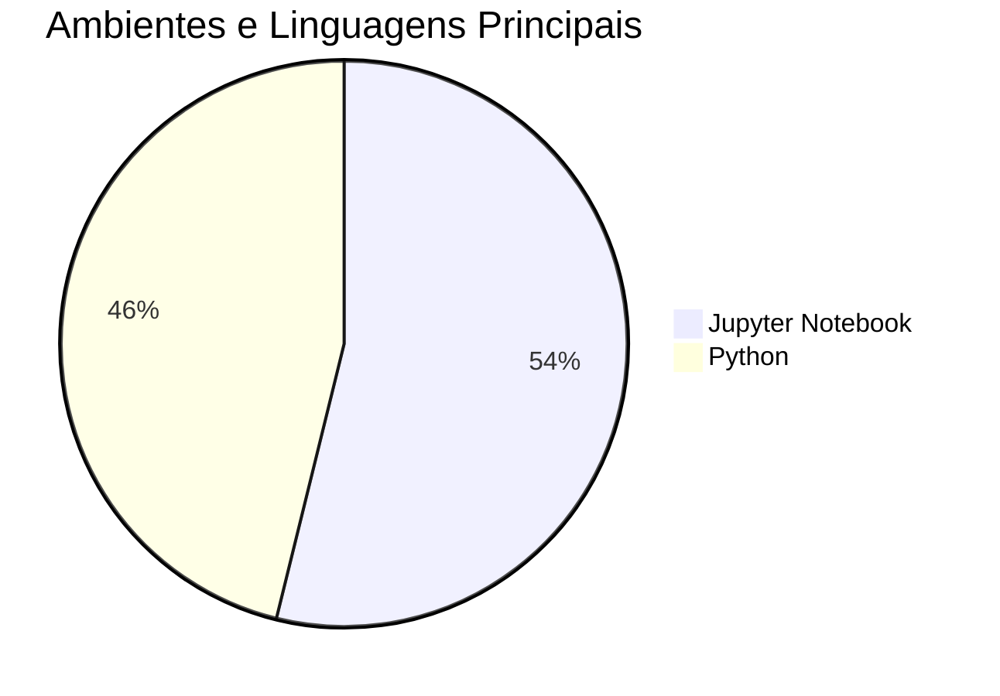

<table align="center" border="1" cellpadding="5" cellspacing="0" style="border-collapse: collapse; border: 1px solid black;">
  <tr>
    <td style="border: 1px solid black; padding: 5px;">
      <p style="text-align: center;">Bem-vindos à Organização</p>
      <p style="text-align: center;"><a href="https://github.com/ifsc-sj-projetos-ia/" target="_blank">&nbsp;&nbsp;&nbsp;&nbsp;&nbsp;&nbsp;&nbsp;&nbsp;&nbsp;IFSC-SJ-Projetos-IA&nbsp;&nbsp;&nbsp;&nbsp;&nbsp;&nbsp;&nbsp;&nbsp;&nbsp;</a></p>
    </td>
  </tr>
</table>

---

#### IFSC - Campus São José - Projetos de Ciência de Dados e IA

<div align="center">

[](#)
[](#)
[](#)
[](#)
[](#)
[](#)
[](#)

[Website IFSC](https://www.ifsc.edu.br/web/campus-sao-jose) | [GitHub Organization](https://github.com/ifsc-sj-projetos-ia)

</div>

---

#### 📚 Sobre a Organização

Esta organização reúne projetos aplicados de **Introdução à Ciência de Dados (ICD)** e **Aprendizado de Máquina (Machine Learning)** desenvolvidos nas disciplinas ministradas pelo Prof. [Dr. Ramon Mayor Martins](https://rmayormartins.github.io/) no [Instituto Federal de Santa Catarina - Campus São José](https://www.ifsc.edu.br/). Os projetos exploram desde análise exploratória e modelagem preditiva até visão computacional, processamento de linguagem natural (NLP), áudio e séries temporais.

---

#### 🛠️ Disciplinas e Ambientes de Desenvolvimento

| Curso | Disciplina | Linguagem / Stack | Ambiente de Desenvolvimento | Objetivo |
| :--- | :--- | :--- | :--- | :--- |
| Análise e Desenvolvimento de Sistemas | ICD - Introdução à Ciência de Dados | Python / Jupyter | [GitHub Organization](https://github.com/ifsc-sj-projetos-ia) | Coleta, limpeza, análise exploratória de dados e modelagem preditiva com Machine Learning |
| Engenharia de Telecomunicações | Aprendizado de Máquina / IA Aplicada | Python / Jupyter | [GitHub Organization](https://github.com/ifsc-sj-projetos-ia) | Reconhecimento de padrões, processamento de sinais, visão computacional e séries temporais |

---

#### 🗄️ Índice de Projetos de Ciência de Dados e IA

| Data | Curso | Disciplina | Ambiente / Linguagem | Projeto (Repositório) | Tema / Aplicação | Visibilidade |
| :--- | :--- | :--- | :--- | :--- | :--- | :--- |
| 2026-1 | ADS | ICD | Python | [dementia-prediction](https://github.com/ifsc-sj-projetos-ia/dementia-prediction) | Predição de demência com dados clínicos | Público |
| 2026-1 | ADS | ICD | Python | [time-series-foundation-models](https://github.com/ifsc-sj-projetos-ia/time-series-foundation-models) | Modelos fundacionais aplicados a séries temporais | Público |
| 2026-1 | ADS | ICD | Python | [airdrums](https://github.com/ifsc-sj-projetos-ia/airdrums) | Bateria virtual interativa baseada em visão computacional | Privado |
| 2026-1 | ADS | ICD | Python | [ChipTune-Copilot](https://github.com/ifsc-sj-projetos-ia/ChipTune-Copilot) | Assistente de IA para geração de música estilo 8-bit | Privado |
| 2026-1 | ADS | ICD | Jupyter Notebook | [music-genre-classification](https://github.com/ifsc-sj-projetos-ia/music-genre-classification) | Classificação automática de gêneros musicais | Público |
| 2026-1 | ADS | ICD | Jupyter Notebook | [hate-speech-detection](https://github.com/ifsc-sj-projetos-ia/hate-speech-detection) | Identificação de discurso de ódio, toxicidade e cyberbullying | Privado |
| 2026-1 | ADS | ICD | Jupyter Notebook | [Previs-o-de-Sucesso-de-Filmes](https://github.com/ifsc-sj-projetos-ia/Previs-o-de-Sucesso-de-Filmes) | Modelo preditivo de desempenho e sucesso de filmes | Público |
| 2026-1 | ADS | ICD | Jupyter Notebook | [predicao-evasao-escolar](https://github.com/ifsc-sj-projetos-ia/predicao-evasao-escolar) | Predição precoce e prevenção proativa de evasão escolar | Público |
| 2026-1 | ADS | ICD | Python | [classificador-de-cartas](https://github.com/ifsc-sj-projetos-ia/classificador-de-cartas) | Visão computacional para reconhecimento de cartas de baralho | Público |
| 2026-1 | ADS | ICD | Jupyter Notebook | [magician-red](https://github.com/ifsc-sj-projetos-ia/magician-red) | Detecção rápida de focos de incêndio por imagem | Público |
| 2026-1 | ADS | ICD | Python | [tour-prediction](https://github.com/ifsc-sj-projetos-ia/tour-prediction) | Previsão de público e receita de turnês de K-pop | Público |
| 2026-1 | ADS | ICD | Jupyter Notebook | [game-viability-system](https://github.com/ifsc-sj-projetos-ia/game-viability-system) | Análise de viabilidade mercadológica de jogos | Público |
| 2026-1 | ADS | ICD | Jupyter Notebook | [corrige-aqui](https://github.com/ifsc-sj-projetos-ia/corrige-aqui) | Auxílio automatizado na correção e avaliação textual | Público |

---

#### 🖥️ Distribuição de Tecnologias e Ambientes



---

*Última atualização: Novembro de 2026*

#### 🧰 Mantenedor
```text
Prof. Dr. Ramon Mayor Martins
Professor do IFSC - Campus São José
Áreas: Ciência de Dados, Aprendizado de Máquina e Inteligência Artificial
Website Pessoal: [https://rmayormartins.github.io/](https://rmayormartins.github.io/)
```

---

#### 📝 Licença

A maioria dos projetos públicos desta organização utiliza a licença **MIT**. Consulte o arquivo `LICENSE` em cada repositório individual para mais detalhes.

---

<div align="center">
  
#### IFSC - Campus São José - Projetos de IA

</div>
